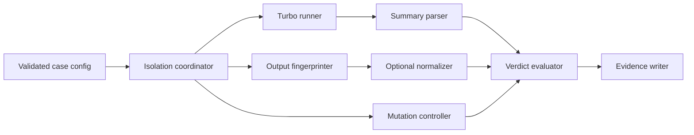

# Phase 3 Step D-1 — Generic verification engine design

Design date: 2026-11-09 (Asia/Seoul)

## 1. Executive summary

The MVP verifies a local Turborepo project in disposable workspaces. It creates a cache from an
input state, applies an optional controlled mutation, runs the mutated state against that cache,
and compares the result with two independently built clean baselines. A verdict is based on
task-level Turbo cache evidence plus output evidence; directory differences alone can never prove
stale reuse.

The smallest useful engine has five parts: configuration validation, workspace/cache isolation,
Turbo execution and summary parsing, raw/optional normalized output comparison, and versioned
evidence writing. Framework-specific normalization is supplied as data by the user or a separately
selected policy. The generic engine does not contain Next.js, Basic, package-name, or output-path
special cases.

This document designs D-1 only. It does not add a command or production implementation.

## 2. Findings from existing code and evidence

### Repository state inspected

- Branch: `codex/phase-3-real-world-verification`
- Baseline commit at design start: `2e3dc7672976e0d2a24329d5ad10a3c012595998`
- The worktree was clean before this document was created.
- The project is TypeScript/Node.js ESM, requires Node 22 or newer, uses Commander and Vitest, and
  has no general-purpose glob, schema, or process-tree dependency.

### Existing implementation

- `src/process.ts` already captures command, arguments, exit code, signal, stdout, stderr, timeout,
  and duration. Its Windows timeout path terminates a process tree with `taskkill`.
- `src/workspace.ts` copies a fixture beside its source, creates a cache directory, and guarantees
  cleanup with `finally`. It deliberately avoids AppContainer temp paths on Windows.
- `src/turbo.ts` invokes pinned Phase 2 Turbo binaries and parses one task from a summary. Its
  assumptions—two hard-coded Turbo versions, `build`, and exactly one task—are too narrow for D-2.
- `src/fingerprint.ts` correctly hashes one file with SHA-256 but has no tree manifest, exclusions,
  comparison, or normalization contract.
- Phase 2 scenario classifiers already enforce useful principles: failed/timed-out builds are
  environment errors, missing cache evidence is inconclusive, and a stale/unsafe result needs a
  local HIT plus baseline output disagreement.
- `src/cli.ts` maps PASS to 0, defect statuses to 1, INCONCLUSIVE to 2, and ENVIRONMENT_ERROR to 3.
  D-2 must not alter these scenario contracts or mappings.

### Evidence-derived constraints

Step B proved that a genuine local HIT is observable in Turbo summary JSON through task ID, hash,
`cache.status`, `cache.local`, and `cache.remote`. Removing outputs and using a distinct,
previously absent local cache made the clean builds independent; `--force` was neither used nor
sufficient by itself.

Raw Basic baselines differed because Next.js generated random build IDs, cryptographic keys, and
diagnostic traces. After an explicit policy normalized the identifiers/keys and omitted only trace
diagnostics, two retained clean baselines and the cached output matched. Therefore raw manifests
must always be retained, normalized comparison is optional, and normalization must be auditable.

Step C established four task-level patterns:

- C1: unchanged inputs produced local HITs and output equal to clean baselines;
- C2: the changed app missed while an unaffected app hit;
- C3: a shared source package with no build task invalidated both consuming app tasks;
- C4: an input exclusion fixed before cache population caused unchanged hashes and local HITs, but
  cached output lacked the v2 marker and differed from the clean v2 baseline in eight functional
  files.

Consequently, a run cannot have one undifferentiated expected cache state. Expectations and
observations belong to selected task IDs. Consumer tasks matter even when the changed package has
no runnable task. C4 is a successful injected-fault detection, not evidence of a defect in a
correctly configured Turbo version.

The stored Step B/C evidence contains summaries, stdout/stderr, timing, raw and normalized
manifests, source/config diffs, and compact result metadata. It does not contain a portable formal
normalizer definition, a machine-verifiable command environment allowlist, or two independent
normalized baselines for every C2–C4 case. D-4 must regenerate those cases under the new engine
rather than treating the hand-authored evidence as an automated regression oracle.

## 3. MVP scope and non-goals

### In scope

- A local, already installed Turborepo project.
- One Turbo task name with one or more selected package/task IDs.
- No mutation, one file-content mutation, or a preconfigured fault fixture.
- Per-task expected HIT or MISS.
- Dedicated local cache and output cleanup for every run.
- Two independent mutated-state clean baselines.
- SHA-256 manifests over declared output roots.
- Optional declarative text normalization and explicit file omission.
- JSON evidence plus referenced raw logs and manifests.
- Sequential builds by default, with a user-set low Turbo concurrency.

### Explicitly unsupported in the MVP

- Remote-cache correctness, authentication, or credential handling.
- Running untrusted repositories in a security sandbox.
- In-place mutation of the user's project.
- Mid-build mutation (Phase 2 S02 remains scenario-specific).
- Binary rewriting, AST transforms, arbitrary normalization code, or plugin execution.
- Multiple successive mutations in one case.
- Automatic proof that arbitrary source changes are functionally meaningful.
- Non-Turbo build systems, services, watch/persistent tasks, and interactive commands.
- Package installation, lockfile repair, repository cloning, or Git checkout.
- Automatic framework-specific normalization.
- shadcn/ui and Astro execution in D-2/D-3.

The engine is a verifier, not an environment provisioner. Dependency installation remains an
explicit prerequisite because it can run lifecycle scripts, use credentials, and alter lockfiles.

## 4. Proposed architecture



The orchestration layer owns the lifecycle and passes immutable observations to a pure verdict
evaluator. It must not derive a verdict while a build is still running. Evidence writing occurs
after evaluation but records partial observations on failure.

Proposed production layout for later milestones:

```text
src/
  verification/
    config.ts          parse and validate the MVP contract
    engine.ts          deterministic lifecycle orchestration
    mutation.ts        isolated file replacement and verification
    outputs.ts         output discovery, cleanup, manifests, diffs
    normalize.ts       declarative normalization only
    verdict.ts         pure task/output decision logic
    evidence.ts        schema types, redaction, atomic writer
  turbo.ts             generalized invocation and multi-task summary parsing
  workspace.ts         extended isolated-workspace primitives
  process.ts           reused process execution
  fingerprint.ts       extended SHA-256 tree manifest functions
```

There is no provider framework or normalizer plugin API in the MVP. A single internal interface
between orchestration and comparison is enough.

## 5. Configuration and mutation contracts

### Proposed TypeScript contract

These interfaces are design pseudocode, not production declarations:

```ts
interface VerificationCaseConfig {
  schemaVersion: "1";
  id: string;
  projectRoot: string;
  turbo: {
    command: string;
    task: string;
    packages?: string[];
    concurrency?: number;
    timeoutMs: number;
    environment?: Record<string, string>;
  };
  tasks: Array<{
    id: string;                    // e.g. web#build
    expectedAfterMutation: "HIT" | "MISS";
  }>;
  outputs?: Array<{
    taskId: string;
    include: string[];
    exclude?: string[];
  }>;
  mutation: NoMutation | ReplaceFileMutation;
  preparedFault?: {
    kind: "intentional-input-exclusion";
    description: string;
    changedConfigFiles: string[];
  };
  functionalChecks?: Array<{
    output: "cache" | "baseline";
    glob: string;
    contains?: string;
    notContains?: string;
  }>;
  normalization?: NormalizationPolicy;
  evidenceDirectory: string;
  keepWorkspaces?: "never" | "on-failure" | "always";
}

type NoMutation = { kind: "none" };

interface ReplaceFileMutation {
  kind: "replace-file";
  path: string;
  expectedBeforeSha256: string;
  replacementFile: string;
  expectedAfterSha256: string;
}

interface NormalizationPolicy {
  id: string;
  description: string;
  omit: Array<{ glob: string; reason: string }>;
  textReplacements: Array<{
    glob: string;
    pattern: string;
    replacement: string;
    reason: string;
  }>;
}
```

`replacementFile` is read as bytes from outside the target and copied into the disposable
workspace. Embedding arbitrary scripts or shell commands in mutation configuration is unsupported.
Text normalization patterns are constrained, validated regular expressions with fixed replacement
text; they run only on files accepted as text and within configured output roots.

### Required user settings

- Local project root and evidence destination.
- Turbo executable/command, task, timeout, and selected task IDs.
- Expected post-mutation cache state for every selected task.
- Mutation file, exact before/after hashes, or explicit no-mutation.
- Output paths if Turbo does not report usable expanded outputs.
- Functional checks when the mutation is claimed to affect output.
- Any normalization/omission rule and its justification.
- An explicit `preparedFault` declaration for intentional bad configuration.

Package filters are optional only when the selected task IDs unambiguously identify the complete
run. Environment values affecting hashes or builds must be supplied explicitly; inherited
credentials are not evidence configuration.

### Safely discoverable settings

- Node, package-manager, Turbo, OS, architecture, and CacheTrust versions.
- Git remote identity and commit when available, with credentials removed.
- Package/task graph, dependency/dependent IDs, hashes, cache status, resolved task definition,
  declared/expanded outputs, and Turbo version from summary JSON.
- Project-relative output files, byte counts, and SHA-256 hashes.
- Command exit status, duration, timeout, and sanitized stdout/stderr.

Discovery is observational. It must not silently change the configured task selection or broaden
which output trees can be deleted.

### Mutation safety and restoration

The original project is read-only input. The engine copies it to three sibling disposable roots:
one cache experiment and two clean baselines. It records the source file hash before copying and
verifies the original again at the end. All writes and output deletion are restricted to resolved
paths beneath disposable roots; symlinks/reparse points that escape a root are rejected.

For a file mutation, each copy must match `expectedBeforeSha256`, receive the identical replacement,
and match `expectedAfterSha256`. The experiment copy is restored and checked before cleanup for
auditability, although deletion of the copy is the primary safety boundary. Failure to apply or
restore the mutation is `ENVIRONMENT_ERROR` with `MUTATION_OPERATION_FAILED`; a before-hash mismatch
is `INCONCLUSIVE` with `PRECONDITION_MISMATCH`, because the requested experiment was not run against
the claimed input.

A functional mutation requires an independent-baseline check proving expected content presence or
absence, or another user-declared output assertion. If the clean baseline does not show the effect,
the result is `INCONCLUSIVE` with `MUTATION_EFFECT_UNPROVEN`; fingerprint differences alone do not
prove the intended functional effect.

### C4 configuration decision

Changing `turbo.json` is not the v1-to-v2 mutation. The input exclusion must be a separately
prepared fault in every disposable copy before the v1 cache is populated and must remain byte
identical thereafter. The source file alone changes between v1 and v2. This ordering prevents a
configuration change from invalidating the cache or confusing the cause.

The MVP records a `preparedFault` declaration and verifies the listed config hashes across runs,
but does not edit Turbo configuration. D-4 may prepare the Basic fault fixture with test code before
calling the engine. Reports must label such a result `injectedFault: true`; it is not an upstream
Turbo defect claim.

## 6. Verification lifecycle

### Preparation and v1 cache population

1. Parse configuration; resolve every path; reject unknown fields, escaping paths, duplicate task
   IDs, missing expectations, unsupported mutation kinds, and unsafe output roots.
2. Check prerequisites without installing anything: project readability, command availability,
   working dependency state, supported Turbo summary capability, and evidence-directory safety.
3. Record sanitized environment/tool versions and the original project identity/hash preconditions.
4. Create the cache experiment plus baseline A and B from the same source snapshot. Use a dedicated
   cache directory for the experiment and two distinct, initially absent baseline caches.
5. Apply any already-prepared fault identically before v1 in all copies and verify its hash remains
   fixed. No source mutation is applied yet.
6. Remove only validated declared outputs in the experiment copy. Run v1 with remote caching
   disabled and the dedicated experiment cache. Require a successful summary for every selected
   task and retain hashes/cache observations.

### Mutated cache-enabled run

7. Apply the mutation to the experiment copy and verify its after-hash. For C1, verify that the input
   snapshot is unchanged.
8. Remove declared outputs without deleting the experiment cache. Run the cache-enabled build and
   capture all selected task hashes and local/remote HIT/MISS states.
9. Fingerprint restored/generated outputs immediately. Run configured functional checks.

### Independent mutated baselines

10. Apply the identical mutation to baseline A and B and verify hashes. Remove outputs. Build each
    sequentially with its own new cache directory, remote caching disabled, and no access to the
    experiment cache. Require selected tasks to report MISS/local false; otherwise baseline
    independence is unproven.
11. Fingerprint both baselines, apply functional checks, and compare A with B. Preserve raw
    manifests before any normalization.
12. If raw baselines differ and a policy exists, normalize independently and compare again. Record
    every omitted/transformed path and before/after digest. If normalized baselines still differ,
    stop with `INCONCLUSIVE/NONDETERMINISTIC_BASELINE`.

### Evaluation and cleanup

13. Evaluate each task expectation, then output equivalence, then aggregate by verdict precedence.
    Expected MISS cases prove correct invalidation; expected HIT cases can test correct or stale
    reuse. Mixed C2/C3 graphs are valid.
14. Write evidence atomically, including partial evidence for failures. Redact secrets and replace
    workspace roots with stable labels.
15. Restore/check mutation copies, verify the original project precondition hashes are unchanged,
    and remove disposable workspaces according to retention policy. Cleanup failure is recorded as
    a limitation and environment error if sensitive or large artifacts could not be safely removed.

Two baseline builds are mandatory before PASS or MISMATCH. This is stricter than some Step C manual
cases and prevents one lucky normalized comparison from becoming a false conclusion.

## 7. Verdict semantics and decision table

### Public verdicts and exit codes

The generic verifier uses four public verdicts:

| Verdict | Meaning | Exit code |
| --- | --- | ---: |
| `PASS` | All task expectations and stable baseline comparisons agree | 0 |
| `MISMATCH` | Confirmed local cache reuse produced meaningfully stale output | 1 |
| `INCONCLUSIVE` | Required proof is missing, unsupported, or nondeterministic | 2 |
| `ENVIRONMENT_ERROR` | Execution, mutation, isolation, or tooling failed | 3 |

Existing Phase 2 `STALE_HIT` and `UNSAFE_SAVE` statuses remain unchanged and continue to map to 1.
The new engine does not rewrite old evidence or expose those scenario-specific names as generic
verdicts. Detailed `reasonCodes` provide distinctions such as `CORRECT_REUSE`,
`CORRECT_INVALIDATION`, `CONFIRMED_STALE_REUSE`, `LOCAL_HIT_UNPROVEN`,
`NONDETERMINISTIC_BASELINE`, `UNSUPPORTED_CONFIGURATION`, and `BUILD_FAILED`.

Precedence is `ENVIRONMENT_ERROR` over `INCONCLUSIVE` over `MISMATCH` over `PASS`. An unsupported
but well-formed requested behavior is inconclusive; an invalid/unsafe configuration is rejected
before execution and represented as `INCONCLUSIVE/UNSUPPORTED_CONFIGURATION` if evidence is
written. Failures of required commands or isolation are environment errors.

### Decision table

| Expected state and evidence | Output evidence | Verdict / reason |
| --- | --- | --- |
| HIT; actual local HIT, remote false, stable baseline | cached equals baseline | PASS / `CORRECT_REUSE` |
| HIT; actual local HIT with reused task hash | cached meaningfully differs from stable baseline | MISMATCH / `CONFIRMED_STALE_REUSE` |
| HIT; MISS or cache status unavailable | any | INCONCLUSIVE / `LOCAL_HIT_UNPROVEN` |
| MISS; actual MISS and hash changed from v1 | cached-run output equals stable baseline | PASS / `CORRECT_INVALIDATION` |
| MISS; actual MISS but hash unchanged | output equals baseline | INCONCLUSIVE / `INVALIDATION_CAUSE_UNPROVEN` |
| MISS; actual local HIT | any | INCONCLUSIVE / `UNEXPECTED_CACHE_STATE` unless stale-output proof also satisfies MISMATCH |
| Any | baseline A and B differ after approved normalization | INCONCLUSIVE / `NONDETERMINISTIC_BASELINE` |
| Any mutation | independent baseline fails functional assertion | INCONCLUSIVE / `MUTATION_EFFECT_UNPROVEN` |
| Any | build timeout/nonzero exit, summary parse failure required for observation | ENVIRONMENT_ERROR / `BUILD_FAILED`, `TIMEOUT`, or `SUMMARY_INVALID` |
| Unsupported remote-only or persistent task | none | INCONCLUSIVE / `UNSUPPORTED_CONFIGURATION` |

A cache MISS is sufficient for PASS only for a task explicitly expected to MISS, when its hash
changed as expected, its output equals a stable clean baseline, and the mutation effect is proven.
It cannot prove correct cache reuse.

MISMATCH requires all of: successful builds; stable independent baselines; actual local HIT with
remote false for the implicated task; the expected hash relationship; a meaningful cached-versus-
baseline difference after an approved policy; and a proven functional mutation effect. C4 also
requires the fixed prepared-fault declaration.

Raw disagreement with normalized equality may yield PASS only when two independent baselines also
normalize identically and all rules are disclosed. If a rule changes or removes the mutation marker,
functional-check target, or another differing application value, the policy is unsafe and the
result is `INCONCLUSIVE/NORMALIZATION_UNSAFE`. The engine never promotes normalized equality over a
failed semantic guard.

## 8. Reproducible evidence schema

The top-level JSON is versioned independently from CacheTrust:

```ts
interface VerificationEvidenceV1 {
  schemaVersion: "cachetrust.verification/1";
  cachetrustVersion: string;
  caseId: string;
  startedAt: string;
  finishedAt: string;
  environment: {
    os: string; arch: string;
    node: string; packageManager?: string; turbo: string;
  };
  target: {
    repository?: string; commit?: string; dirty?: boolean;
    projectLabel: string; // never an unnecessary absolute path
  };
  config: SanitizedVerificationConfig;
  isolation: {
    sourceSnapshotSha256: string;
    workspaces: Array<{ id: "cache" | "baseline-a" | "baseline-b"; cacheId: string }>;
    remoteCacheDisabled: boolean;
    outputsCleaned: string[];
  };
  mutation: {
    kind: "none" | "replace-file";
    path?: string; beforeSha256?: string; afterSha256?: string;
    diffArtifact?: string; restored: boolean;
    preparedFault?: { kind: string; description: string; configSha256: string };
    functionalChecks: FunctionalCheckResult[];
  };
  runs: Array<{
    id: "v1" | "cache-v2" | "baseline-a-v2" | "baseline-b-v2";
    command: string[]; environmentKeys: string[];
    startedAt: string; durationMs: number; exitCode: number | null; timedOut: boolean;
    stdoutArtifact: string; stderrArtifact: string; turboSummaryArtifact?: string;
    tasks: Array<{ id: string; hash: string; cache: { status: string; local: boolean; remote: boolean } }>;
  }>;
  comparisons: {
    raw: ComparisonRecord;
    normalized?: ComparisonRecord & { policyId: string; policyArtifact: string };
    baselineStable: boolean;
    changedFunctionalFiles: string[];
  };
  verdict: {
    status: "PASS" | "MISMATCH" | "INCONCLUSIVE" | "ENVIRONMENT_ERROR";
    reasonCodes: string[];
    implicatedTasks: string[];
    injectedFault: boolean;
    explanation: string;
  };
  limitations: string[];
}
```

Each comparison references per-file manifests containing only project-relative slash-normalized
paths, sizes, and SHA-256 values. The evidence writer stores commands as argument arrays, redacts
credential-like environment variables and URLs, omits environment values by default, and never
records cache tokens. Repository URLs are sanitized to remove user information and credentials.

Retain in Git when reasonably sized:

- the main JSON, sanitized config, policy, source/config diff, task summaries, manifests, functional
  check results, and stdout/stderr needed to support cache observations;
- command, duration, exit, timeout, and optional sampled memory metadata.

Exclude from Git:

- copied workspaces, `node_modules`, local Turbo caches, full generated output trees, credentials,
  package-manager stores, and core dumps.

Large logs receive SHA-256 and size metadata and may be stored outside Git with an explicit missing-
artifact limitation. Evidence JSON is written to a temporary sibling and atomically renamed only
after successful serialization.

## 9. Existing-code reuse plan

### Reuse unchanged initially

- `runProcess` and `ProcessResult` from `src/process.ts`.
- `fingerprintFile` from `src/fingerprint.ts` as the leaf hash operation.
- Phase 2 scenario implementations, fixtures, tests, statuses, and CLI behavior.

### Extend without changing existing callers

- Add generalized workspace creation alongside `createTemporaryWorkspace`; do not change its
  fixture semantics until new integration tests cover symlinks, output deletion, and multiple
  independent caches.
- Add tree manifest functions beside `fingerprintFile`.
- Generalize Turbo execution with a new function accepting executable, task, filters, cache,
  environment, and multiple expected task IDs. Keep current `runTurbo` as the Phase 2 adapter until
  scenario tests migrate safely.
- Extend `exitCodeFor` only to accept generic `MISMATCH` through a compatible result union in D-3;
  preserve all existing mappings.

### New modules

The seven `verification/` files in the architecture section are sufficient. The verdict evaluator
and normalization logic should be pure and receive already captured data, enabling small unit tests.

### Keep scenario-specific

- Bracket-path input-pattern injection and Turbo 2.11.9 control case.
- Mid-build watcher/marker synchronization and Turbo 2.11.8 replay.
- Basic's Next.js policy, C2/C3 marker strings, and C4 `turbo.json` preparation.

No new runtime dependency is justified at D-1. D-2 should first use Node APIs and the repository's
existing patterns; a glob library is acceptable only if correct Turbo-compatible matching cannot be
implemented safely with a small, well-tested scope.

## 10. D-2/D-3/D-4 roadmap

### D-2 — Core verification engine

Scope: configuration validation, three-workspace isolation, file/no-op mutation, generalized Turbo
summaries, output cleanup/manifests, declarative normalization, pure verdict evaluation, and v1
evidence objects. No Commander changes.

Acceptance criteria:

- original source remains byte-identical;
- experiment and two baselines use distinct caches and cleaned outputs;
- multiple selected tasks retain hashes and local/remote cache state;
- PASS, MISMATCH, INCONCLUSIVE, and ENVIRONMENT_ERROR follow the decision table;
- unsafe paths, unsafe normalization, and missing functional effect cannot produce PASS/MISMATCH;
- partial evidence survives build failure.

Tests: unit tests for config/path validation, summary parsing, manifests, normalization safety, and
every verdict row; lightweight fake-Turbo integration tests for HIT/MISS, timeout, failed baseline,
cross-cache contamination, mutation preconditions/restoration, and Windows path separators.

Expected evidence: deterministic fixture JSON and manifests generated in temporary directories.

Non-goals: CLI, real Basic builds, install/clone, remote cache, S02 generalization, framework policy
auto-detection.

### D-3 — CLI integration

Scope: one new command accepting a config file and evidence directory, concise progress/output,
schema validation errors, retention choice, and exit-code integration.

Acceptance criteria:

- old `list` and `run` commands and their 0/1/2/3 behavior remain unchanged;
- generic PASS/MISMATCH/INCONCLUSIVE/ENVIRONMENT_ERROR map to 0/1/2/3;
- JSON is sanitized and atomically persisted on success and handled failures;
- Ctrl-C/timeout terminates child trees and performs safe cleanup.

Tests: Commander argument tests, status mapping, invalid/unsafe config, evidence write failure,
interrupt/timeout cleanup, and Windows quoting/path cases.

Expected evidence: small fixture CLI transcripts and schema-v1 JSON.

Non-goals: interactive setup, auto-install, remote execution, rich UI, plugin system.

### D-4 — Basic C1–C4 automated regression verification

Scope: Basic-specific test configs, a separately prepared C4 fault copy, and the audited Next.js
normalization policy. Run C1–C4 sequentially against the pinned commit/toolchain.

Acceptance criteria:

- C1 PASS with genuine local HIT;
- C2 PASS with web MISS and unaffected docs HIT;
- C3 PASS with both consumer tasks MISS despite no `@repo/ui` build task;
- C4 MISMATCH with unchanged/reused task hash, genuine local HIT, stable v2 baselines, missing v2
  content in cache output, and present v2 content in baseline output;
- raw and normalized manifests plus every rule are preserved;
- C4 is labeled an injected fault, not an upstream defect.

Tests: cheap unit coverage remains in the default suite; the pinned real-project suite is an
explicit slow integration target with timeout and disk-space checks. Heavy builds run sequentially
with Turbo concurrency 2 on the 16 GB Windows host.

Expected evidence: schema-v1 JSON, Turbo summaries, source/config diffs, raw and normalized
manifests, functional marker results, logs, durations, and limitations.

Non-goals: shadcn/ui, Astro, generalized fixture authoring, performance benchmarking, or CI matrix
expansion.

## 11. Risks, unresolved questions, and decisions requiring approval

### Recommended decisions

1. Require two clean baselines for both PASS and MISMATCH. This costs one extra build but closes the
   largest false-positive path observed in Step B.
2. Treat C4 config modification as fixture preparation, not a runtime mutation.
3. Require per-task expected HIT/MISS and functional checks; do not infer intent from hashes alone.
4. Keep normalization declarative and opt-in. Store Basic's Next.js rules with D-4 configuration,
   not in the engine.
5. Keep the four generic verdicts while preserving Phase 2's named defect statuses and exit codes.

### Unresolved before D-2

- **Output source of truth:** prefer Turbo summary declared/expanded outputs, but require configured
  output roots when the summary is absent or too broad. Approval is needed on whether a mismatch
  between configured and discovered outputs should reject the run or merely be inconclusive. The
  safer recommendation is rejection as `UNSUPPORTED_CONFIGURATION`.
- **Repository copy exclusions:** copying `node_modules` makes real projects practical but may carry
  junctions and platform-specific links. D-2 needs an approved policy: preserve a read-only shared
  install only when links stay inside the source, or require each isolated copy to start from a
  user-prepared installed snapshot. The latter is safer; the former is faster on Windows.
- **Normalization syntax:** JavaScript regular expressions are minimal but can be expensive or
  overly broad. D-2 should cap file size, rule count, and execution time; approval is needed before
  allowing regex rather than literal/JSON-field replacements only.
- **Git cleanliness:** a dirty local project can still be copied reproducibly by content hash, but
  cannot be identified by commit alone. Recommendation: allow it only with an explicit flag and
  record `dirty: true` plus the source snapshot digest.

### Remaining risks

- Turbo summary formats may vary across versions; unsupported shapes must be reported, never
  guessed.
- Windows junctions, antivirus locks, and delayed process-tree termination can disrupt cleanup.
- Framework nondeterminism can exceed safe declarative normalization and force INCONCLUSIVE.
- A content marker proves the selected mutation but not all application semantics; stronger checks
  remain project-supplied.
- Full output manifests and logs may contain generated secrets. Redaction and Git-retention review
  are required before publishing evidence.

Subject to the four decisions above, D-2 is ready to begin. The architecture intentionally leaves
package installation, remote cache, framework plugins, and additional upstream projects outside the
MVP.
